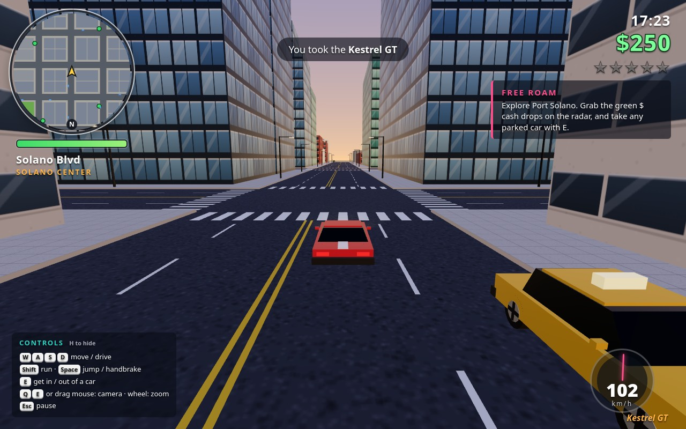

# Port Solano — Sun. Sand. Sirens.

An open-world crime game for the desktop browser, built with Three.js. Port Solano is an
original sun-soaked coastal city: glass towers downtown, pastel art-deco along Marisol Beach,
stucco homes up in Palm Heights, warehouses in Dockside, palm-lined parks, and an ocean that
catches the sunset. Walk it, steal any parked car and drive it, and watch the city light up
as the clock rolls into night.



## Play

```sh
node serve.ts          # then open http://localhost:8080 in Chrome, Edge or Firefox
```

No build step and no network: everything is static files under `game/`, with Three.js
vendored as a minified module (`game/vendor/three.min.js`) and loaded through an import map.

## Controls

| Key | On foot | In a car |
| --- | --- | --- |
| `W` `A` `S` `D` / arrows | walk (camera-relative) | throttle, brake / reverse, steer |
| `Shift` | run | — |
| `Space` | jump | handbrake (slide the back end out) |
| `E` (or `F`) | get into the nearest car | get out (when slow enough) |
| `Q` / `E`, mouse drag | turn the camera | look around (it swings back behind you) |
| mouse wheel | zoom | zoom |
| `H` | hide or show the controls card | |
| `Esc` / `P` | pause | pause |

## What's in it

- **The city** — an 8 × 8 grid of blocks laid out from a seed: roads with double yellow centre
  lines, lane dashes and crosswalks, raised sidewalks, street lamps, palms, parks with fountains,
  and buildings with procedurally painted facades (window grids, glass reflections, brick,
  deco stripes) whose windows light up at night. A sand beach and a shaded, moving ocean line
  the east side.
- **On foot** — a jointed third-person character with walk and run cycles, jumping, kerb
  stepping and collision against buildings and cars.
- **Driving** — four car types (Kestrel GT sports car, Mariner sedan, Bayline Cab, Ridgeback
  SUV) with arcade physics: acceleration curves, braking and reverse, speed-sensitive steering,
  tyre grip and handbrake slides, body lean, spinning and steering wheels, crash bounces and
  car-to-car shoves. Headlights shine at night.
- **Camera** — a smoothed chase camera that orbits on foot, swings in behind the car, widens
  its field of view with speed, shakes on crashes and pulls in instead of clipping walls.
- **HUD** — rotating radar minimap (roads, blocks, parks, beach, cars, cash drops, north),
  health bar, money counter, clock, wanted stars, street and district names, objective panel,
  speedometer and toasts.
- **Day and night** — a running clock drives sky colour, sun and moon, fog, stars,
  reflections, lit windows and lamp light.
- **Cash drops** — green bundles around town (marked on the radar) that pay out and respawn.

## Screenshots

`shots.json` lists deterministic scenes (`?shot=drive|foot|night|title&seed=1`): each starts a
fresh session and plays the real simulation forward with scripted controls, so the same seed
always gives the same frame. `node tools/shoot.ts` serves the game, opens each scene in headless
Chromium and saves JPEGs to `screenshots/`.

## Source layout

```
game/index.html, game/styles.css   page, HUD markup, title and pause screens
game/src/main.js                   renderer, frame loop, menus, ?shot= staging
game/src/game.js                   the session: world, player, cars, camera, HUD, clock
game/src/config.js                 tuning numbers
game/src/city/                     layout, colliders, facades, buildings, streets, street props
game/src/world/                    sky, time of day, environment light, coast, cash drops
game/src/actors/                   character model and on-foot player
game/src/vehicles/                 car models, car physics, the fleet
game/src/camera/                   chase camera
game/src/ui/                       HUD, minimap, menus
game/src/core/                     input, maths, seeded random, geometry merging
```

## Licence

MIT. Three.js is © its authors, MIT licensed.
